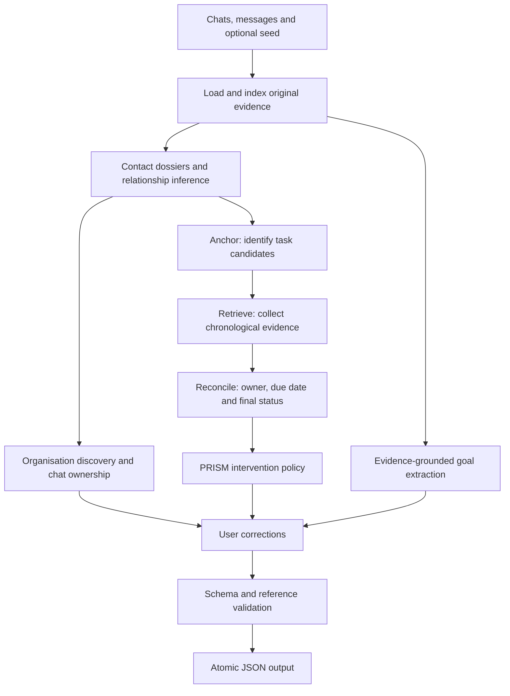

# Xpert Cold Start · Dossier–ARR–PRISM

**Turn WhatsApp conversation history into an evidence-grounded picture of a person's relationships, organisations, goals and unfinished work.**

[](https://github.com/Sohamgaonkhadkar/xpert-cold-start/actions/workflows/ci.yml)


Built for the [Xpert Cold Start Challenge](https://goals.xpert.chat/w/intern). This Python batch engine reads an exported dataset and writes one validated JSON file. It does not connect to WhatsApp or require a database, frontend or background service.

> **Verified grading profile:** the two-argument command uses deterministic inference, even when model credentials are present. Official dev: **28.9526/56**, **zero model calls**. Hybrid inference is an explicit experimental option; its final-source quality has not been independently verified with a funded model run.

## Contents

- [What it produces](#what-it-produces)
- [Quick start](#quick-start)
- [Input and output](#input-and-output)
- [Architecture](#architecture)
- [Execution modes](#execution-modes)
- [Configuration](#configuration)
- [Verified results](#verified-results)
- [Evaluation and testing](#evaluation-and-testing)
- [Corrections](#corrections)
- [Reliability and privacy](#reliability-and-privacy)
- [Repository guide](#repository-guide)
- [Known limitations](#known-limitations)

## What it produces

| Component | Output |
|---|---|
| People | One supported relationship circle per person, organisation links and staff care relationships |
| Organisations and chats | Associated organisations with type, side and role; one person or organisation owning each chat |
| Goals | Up to ten supported goals with area, type, horizon and source-message evidence |
| Open loops | Commitments, follow-ups, deadlines and questions, including owner, source, due date and final status |
| Intervention | `assist`, `remind` or `leave` for every open loop, with a next step, approval requirement, reminder time or reason |

Supported circles: `spouse`, `child`, `parent`, `in-law`, `sibling`, `relative`, `friend`, `colleague`, `client`, `vendor`, `partner` and `staff`.

The engine handles English and common Hindi, Bengali and Hinglish cues, preserves speaker identity, and treats voice transcripts as text evidence. Multilingual coverage is rule-based and incomplete.

## Quick start

### Requirements

- Python **3.10 or newer**.
- Bash; use Git Bash on Windows.
- No API key or third-party Python package is required for default inference. An internal stdlib validator supports the official schema when `jsonschema` is absent.

```bash
git clone https://github.com/Sohamgaonkhadkar/xpert-cold-start.git
cd xpert-cold-start
git switch codex/final-evaluation-hardening

# Run the included public worked example.
bash run.sh example outputs/example.json

# Validate and score it with the official checker.
python3 check.py example outputs/example.json
```

For your dataset:

```bash
bash run.sh /path/to/input /path/to/output.json
```

Paths may contain spaces and are resolved relative to the caller. Input and output can be outside the repository. The process returns nonzero on missing input, unresolved validation errors or other reported failures.

Install the development and hybrid dependencies when needed:

```bash
python3 -m venv .venv
source .venv/bin/activate             # Git Bash on Windows: source .venv/Scripts/activate
python3 -m pip install -r requirements.txt
```

See [SUBMISSION.md](SUBMISSION.md) for the challenge handoff. Use an immutable commit SHA as the commit to grade.

## Input and output

```text
input/
├── chats.jsonl       # Chat IDs, names and participant IDs
├── messages.jsonl    # Message IDs, chat/sender IDs, timestamps, kind and body
└── seed.json         # Optional known relationships, organisations and goals
```

`ME` identifies the user. The [public example](example/) demonstrates the exact format. Message kinds include `text`, `voice_transcript`, `image_caption` and `document`.

The output follows [schema.json](schema.json) and contains five top-level arrays:

```json
{
  "people": [],
  "organisations": [],
  "chats": [],
  "goals": [],
  "open_loops": []
}
```

This illustrates the structure; actual records reference input IDs. `source_msg`, goal evidence and closure messages retain their original message IDs. A completed or dropped loop requires closing evidence. Inference never reads `answers/`; only evaluation tools use reference answers.

## Architecture



| Layer | Responsibility | Main modules in `src/` |
|---|---|---|
| Evidence index | Original turns, participants, dates and lexical retrieval | `data_loader.py`, `conversation_index.py`, `indic_normalizer.py` |
| Dossiers | Contact names, seed labels, group context and speaker-attributed messages | `relationship_inference.py`, `organisation_inference.py` |
| Goals | Message support and user endorsement; maximum ten goals | `goal_extraction.py` |
| ARR | **Anchor–Retrieve–Reconcile**: extract, deduplicate and resolve task evidence | `loop_extraction.py`, `temporal_resolver.py` |
| PRISM | Asymmetric decision costs for assistance, reminders and restraint | `intervention_policy.py` |
| Output contract | Corrections, safe repairs, validation and atomic writing | `corrections.py`, `evidence_validator.py`, `submission_validator.py`, `output_builder.py` |

See [ARCHITECTURE.md](ARCHITECTURE.md) for the current design and trade-offs. PRISM's class weights are engineering assumptions, not empirically calibrated probabilities.

## Execution modes

| Mode | Select with | Network and cost | Intended use |
|---|---|---|---|
| **Deterministic** | Default, or `--mode deterministic` | No model calls; $0 model inference cost | Verified grading profile and offline runs |
| **Hybrid** | `--mode hybrid` | Selective OpenAI-compatible model calls with client limits | Explicit experiments; final-source quality remains unverified |

Hybrid mode supplements uncertain relationship, organisation, goal, loop and intervention decisions. Deterministic validation and closure safeguards still apply. Setting an API key does **not** activate hybrid mode.

```bash
export LLM_BASE_URL=https://openrouter.ai/api/v1
export LLM_API_KEY='<your private key>'
export LLM_MODEL=openai/gpt-4.1-mini
export LLM_USAGE_LOG=private-reports/usage.jsonl

bash run.sh data/dev private-reports/hybrid.json \
  --mode hybrid \
  --telemetry private-reports/hybrid-telemetry.json
```

`openai/gpt-4.1-mini` and `openai/gpt-4o-mini` returned real responses in earlier testing. Credit failures prevented a clean final hybrid comparison. Those historical measurements are in [EVALUATION.md](EVALUATION.md); they do not establish the quality of the current hybrid implementation.

## Configuration

### CLI options

| Option | Purpose |
|---|---|
| `--mode deterministic\|hybrid` | Inference mode; default is `deterministic` |
| `--telemetry PATH` | Stage timing, model usage, cost details and repair counts |
| `--corrections PATH` | Structured or supported natural-language corrections |
| `--schema PATH` | Explicit schema file |
| `--quiet` | Suppress the completion summary on stderr |

Run `python3 -m src.cli --help` for the full interface.

### Hybrid environment variables

| Variable | Default / purpose |
|---|---|
| `LLM_BASE_URL` | OpenAI-compatible API base URL |
| `LLM_API_KEY` | Private provider credential |
| `LLM_MODEL` | Exact provider model ID |
| `LLM_USAGE_LOG` | Optional local JSONL usage log |
| `LLM_MAX_CONCURRENCY` | `6`; use `1` when testing a small-credit account |
| `LLM_MAX_WALL_SEC` | `1380` seconds for model work |
| `LLM_MAX_COST_USD` | `2.50` estimated admission budget |
| `LLM_INPUT_COST_PER_1M` | Optional input-token rate for estimation |
| `LLM_OUTPUT_COST_PER_1M` | Optional output-token rate for estimation |

Admission costs are estimates. Provider-reported billing is recorded separately when available; failed requests can omit usage. Temporary in-flight credit holds and exhausted account credit are handled separately. These controls do not guarantee provider availability.

## Verified results

Recorded on **12 November 2026**. The official dev set contains **4,502 messages, 138 chats and 286 people**.

| Official dev category | Points |
|---|---:|
| Circles | 9.0732 / 12 |
| Organisations | 3.6958 / 8 |
| Chat ownership | 6.3415 / 8 |
| Open loops found | 3.9773 / 14 |
| Open loops closed correctly | 5.8649 / 14 |
| **Total measurable on dev** | **28.9526 / 56** |

Goals and intervention decisions are **unlabelled in dev**. Their accuracy and the full competition score cannot be inferred from this total.

| Verification | Recorded result |
|---|---|
| Development improvement | 19.7995 → **28.9526 / 56** |
| Labelled loops found | **50 / 74** among 278 predictions |
| Label-based precision / recall / F1 | **17.99% / 67.57% / 28.41%** |
| False DONE among matched loops | **0** |
| Public worked example, including zero-seed variant | **74 / 74** |
| Regression suite | **125 passing tests** |
| CI environments | Python **3.10, 3.12, 3.14** and a clean **3.12 container** |
| Dense synthetic runtime | **63.88 s**: 20,000 messages, 320 chats, 5,000 designed task cases |
| Graded profile model usage | **0 calls, 0 tokens, $0** |

The dense fixture tests local runtime and designed cases; it is not hidden-set accuracy or network latency. Dev results were obtained after iterative tuning. Incomplete labels mean unmatched predictions are not automatically invalid tasks.

Evidence: [final verification](metrics/submission_verification.json), [evaluation report](EVALUATION.md), [11 November ablations](metrics/nov11_evaluation.md) and [12 November corrections](metrics/nov12_evaluation.md).

## Evaluation and testing

### Offline checks

```bash
python3 -m pip install -r requirements.txt
python3 -m pytest -q

bash run.sh example outputs/example.json
python3 check.py example outputs/example.json
python3 -m scripts.evaluate_official example outputs/example.json
```

Tests cover schema/reference integrity, deterministic grading with credentials present, mocked hybrid transport, identity and seed variations, multilingual cues, ownership, partial completion, cross-chat evidence, corrections and shell packaging. Tests isolate credentials and do not spend API credits.

### Official development evaluation

Download the [official dataset](https://goals.xpert.chat/w/intern/data) into ignored `data/dev/`. Keep private data and predictions out of Git.

```bash
bash run.sh data/dev private-reports/dev.json \
  --telemetry private-reports/dev-telemetry.json

python3 check.py data/dev private-reports/dev.json
python3 -m scripts.evaluate_official data/dev private-reports/dev.json \
  --report private-reports/dev-report.json
```

For a deliberately funded hybrid evaluation, the helper reads the named model variables from an explicit local file without printing the key:

```bash
python3 -m scripts.live_evaluation data/dev private-reports/live-run \
  --env-file /path/to/private.env
```

Use a fresh destination for each live run. Historical synthetic scripts remain for regression work; their custom scorer and test-aware mock do not replace `check.py` or real-model measurements. Generated mock benchmark snapshots are intentionally untracked.

## Corrections

The correction layer updates people, organisation records, chat ownership and task ownership/status while recomputing affected interventions.

```bash
python3 -m scripts.correction_demo
bash run.sh example outputs/corrected.json --corrections /path/to/corrections.json
```

Prefer exact person IDs and originating message IDs. Ambiguous names fail clearly, and DONE/DROPPED corrections require later input evidence. Corrections are scoped changes rather than a new global inference rule. See [INTERVIEW.md](INTERVIEW.md) for the ten-minute walkthrough.

## Reliability and privacy

- **Evidence before closure:** acknowledgements, future promises and expired deadlines do not establish completion. Finishing one list item does not finish the bundle.
- **Explicit ownership:** group membership alone does not make an unaddressed request the user's responsibility.
- **Fail-closed output:** safe repairs precede schema and reference checks. Unresolved errors prevent a successful write; valid output replaces the destination atomically.
- **Bounded execution:** the Linux launcher adds a 1,740-second watchdog when `timeout` is available. Model work has a shorter client budget.
- **Restricted network use:** default inference is offline. Explicit hybrid requests go to the configured endpoint; redirects are refused.
- **Private data stays untracked:** ignore rules exclude datasets, credentials, environments, model responses and runtime outputs. Only aggregate evidence belongs in `metrics/`.
- **Transparent records:** `ai-logs/` contains genuine available transcripts, selected excerpts and the original development summary. Missing historical transcripts are disclosed.

Never commit API keys or private conversations. Follow the organisers' data retention requirements.

## Repository guide

```text
src/                 Inference, model transport, corrections and validation
scripts/             Evaluation, synthetic fixtures and development utilities
tests/               Offline unit, integration and adversarial regressions
example/             Official public worked example and permitted answers
metrics/             Aggregate official measurements and rendered write-up
ai-logs/             Genuine available AI-assisted development records
.github/workflows/   Linux validation and clean-container CI
run.sh               Required two-argument entry point
schema.json          Official output contract
check.py             Official validator and scorer
```

| Document | Purpose |
|---|---|
| [ARCHITECTURE.md](ARCHITECTURE.md) | Current pipeline, responsibilities and trade-offs |
| [EVALUATION.md](EVALUATION.md) | Verified measurements, historical experiments and evidence boundaries |
| [WRITEUP.md](WRITEUP.md) · [PDF](metrics/writeup.pdf) | Two-page challenge write-up |
| [SUBMISSION.md](SUBMISSION.md) | Grading profile, submission fields and handoff |
| [INTERVIEW.md](INTERVIEW.md) | Reproducible correction demonstration |
| [AI records](ai-logs/README.md) | Record provenance and transcript availability |

## Known limitations

The final dev run has **24 unmatched reference loops**, **19 matched missed completions**, **six matched owner disagreements** and **ten incorrect unseeded circle labels out of 41**. Organisation membership and chat ownership remain ambiguous for sparse or mixed-role contacts.

Some reference origins are fragments, media, social messages or repeated sources, and some completed labels lack visible closure. The engine does not memorize these cases or duplicate predictions to exploit the checker. Goal and intervention quality cannot be measured from the unlabelled dev categories. Current hybrid quality and hidden-set ranking remain unverified.
